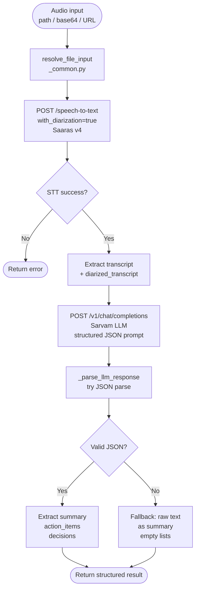
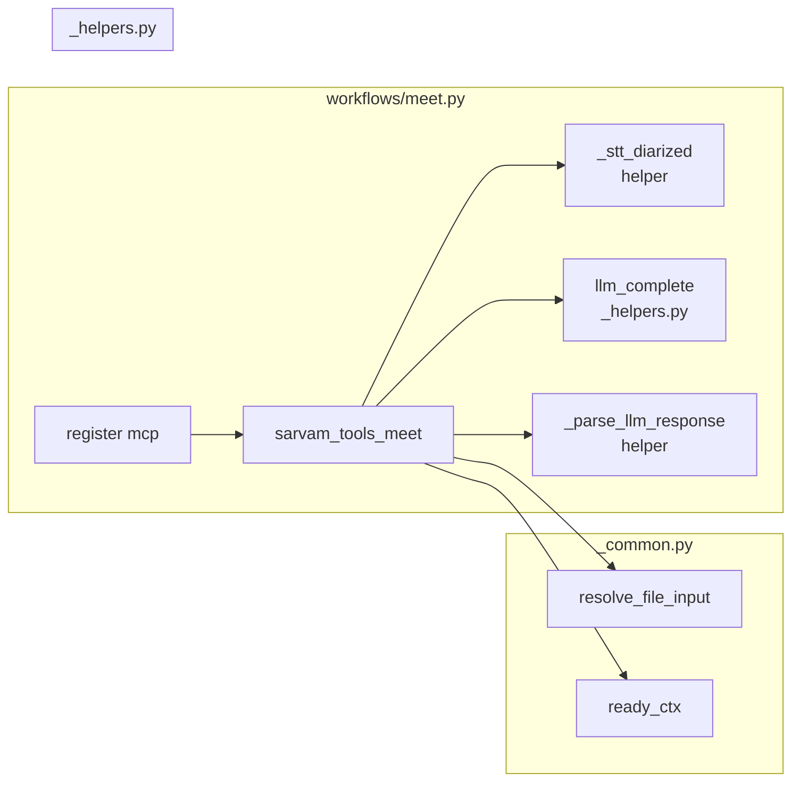

# Feature: `sarvam_tools_meet` — Meeting Transcription & Summarization (Issue #39)

## Problem

There was no end-to-end workflow tool for meeting recordings in Indic languages. Users had to manually chain three separate API calls: STT with diarization → extract transcript → LLM summarization. This required significant boilerplate and domain knowledge.

## New Feature

`sarvam_tools_meet` is a composite workflow tool that accepts an audio file and returns a structured meeting analysis with speaker-labeled transcription, summary, action items, and decisions.

---

## Workflow: sarvam_tools_meet



---

## Architecture



---

## New File: `src/sarvam_mcp/workflows/meet.py`

Key implementation details:

- **Input resolution**: Uses `resolve_file_input` from `_common.py` for path/base64/URL support
- **STT with diarization**: Calls `/speech-to-text` directly with `with_diarization: "true"` (the existing `stt_transcribe` helper in `_helpers.py` does not support diarization)
- **LLM prompt**: Requests JSON output with keys `summary`, `action_items`, `decisions`
- **Safe parsing**: `_parse_llm_response` wraps JSON parse in try/except; falls back to raw text on failure
- **Observability**: All API calls wrapped in `measure_tool()` and merged into a single observability block

## Return Shape

```json
{
  "transcript": "Full meeting transcript text",
  "diarized_transcript": [{"speaker": "SPEAKER_1", "transcript": "..."}],
  "language_code": "hi-IN",
  "summary": "2-3 sentence summary of the meeting",
  "action_items": ["Alice to send report by Friday", "Bob to schedule follow-up"],
  "decisions": ["Approved Q4 budget", "Moved launch to November"],
  "observability": {"latency_ms": 4200, "credits_used": 0.08}
}
```

---

## Registration

Added to `src/sarvam_mcp/server.py`:
```python
workflows.meet.register(mcp)
```

Added to `src/sarvam_mcp/workflows/__init__.py`:
```python
from sarvam_mcp.workflows import meet
```

---

## PR Description

**Title:** feat: sarvam_tools_meet — meeting transcription and summarization (#39)

**Body:**

### Summary

- Adds `sarvam_tools_meet`, a new composite workflow for Indic-language meeting audio.
- Transcribes audio with speaker diarization using Saaras v4.
- Passes the transcript to Sarvam LLM to extract a summary, action items, and decisions.
- Returns a structured JSON response with all results plus observability metrics.

### Changes

- `src/sarvam_mcp/workflows/meet.py`: new workflow module with `register(mcp)` export
- `src/sarvam_mcp/server.py`: registers `workflows.meet`
- `src/sarvam_mcp/workflows/__init__.py`: exports `meet`

### Test plan

- [ ] `ruff check src/` passes
- [ ] `pytest -q` passes
- [ ] Manual: run `sarvam_tools_meet` with a short audio file — verify transcript, summary, action_items, decisions present in response

Fixes sarvamai/sarvam-mcp#39

---

## PR Description (PR #97)

> ## Summary
>
> - Adds `sarvam_tools_meet`, a new composite workflow for Indic-language meeting audio.
> - Transcribes audio with speaker diarization using Saaras v4.
> - Passes the transcript to Sarvam LLM to extract a summary, action items, and decisions.
> - Returns a structured JSON response with all results plus observability metrics.
>
> ## Changes
>
> - `src/sarvam_mcp/workflows/meet.py`: new workflow module with `register(mcp)` export
> - `src/sarvam_mcp/server.py`: registers `workflows.meet`
>
> ## Test plan
>
> - [ ] `ruff check src/` passes
> - [ ] `pytest -q` passes
> - [ ] Manual: run `sarvam_tools_meet` with a short audio file — verify transcript, summary, action_items, decisions are present in response
>
> Fixes sarvamai/sarvam-mcp#39
