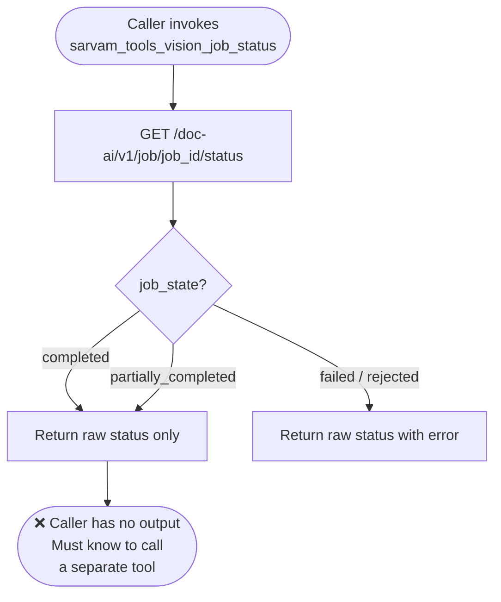
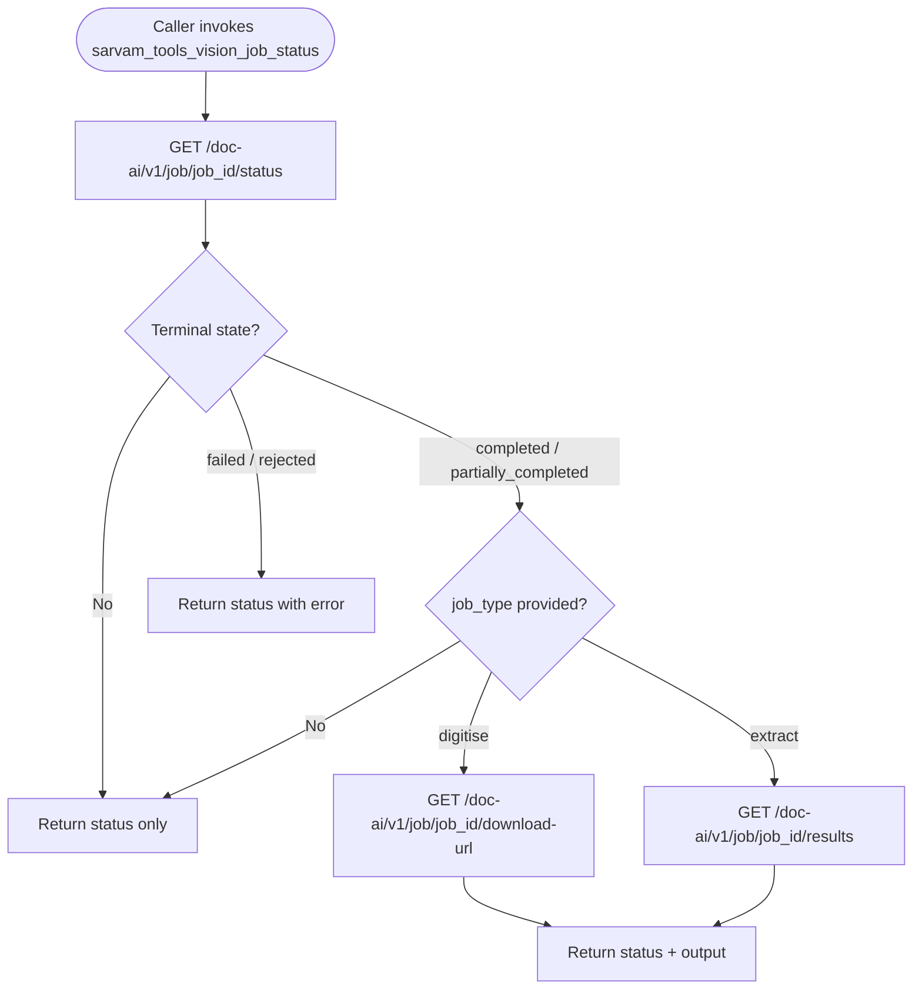

# Fix: `sarvam_tools_vision_job_status` Never Returns Usable Output (Issue #64)

## Problem

When a Document AI job completes successfully, `sarvam_tools_vision_job_status` only returns the raw status metadata. It never calls the download endpoint, so callers have no way to retrieve the actual output (digitized text, extracted fields) through this tool.

The root cause: the tool only calls `GET /doc-ai/v1/job/{job_id}/status` and returns the result as-is, with no follow-up call to fetch the output once the job reaches a terminal success state.

## Affected Tool

- `sarvam_tools_vision_job_status` in `src/sarvam_mcp/tools/vision.py`

---

## Flow: Before Fix



## Flow: After Fix



---

## Code Change

**File:** `src/sarvam_mcp/tools/vision.py`

Added an optional `job_type` parameter to `sarvam_vision_job_status`:

```python
# Before
async def sarvam_vision_job_status(
    ctx: Context,
    job_id: str = Field(description="Job id from vision_digitise or vision_extract."),
) -> dict[str, Any]:
    sc = await ready_ctx(ctx)
    with measure_tool() as metrics:
        status, call = await sc.client.get_json(f"{DOC_AI_BASE}/{job_id}/status")
        metrics.merge(call)
    return {
        "job_id": job_id,
        "status": status.get("status"),
        "usage": status.get("usage"),
        "raw": status,
        "observability": metrics.to_response_block(),
    }

# After
async def sarvam_vision_job_status(
    ctx: Context,
    job_id: str = Field(description="Job id from vision_digitise or vision_extract."),
    job_type: Literal["digitise", "extract"] | None = Field(
        default=None,
        description="Pass 'digitise' or 'extract' to also fetch output when the job is complete.",
    ),
) -> dict[str, Any]:
    sc = await ready_ctx(ctx)
    with measure_tool() as metrics:
        status, call = await sc.client.get_json(f"{DOC_AI_BASE}/{job_id}/status")
        metrics.merge(call)
        output = None
        state = str(status.get("status", "")).lower()
        if state in {"completed", "partially_completed"} and job_type is not None:
            if job_type == "digitise":
                output, call = await sc.client.get_json(f"{DOC_AI_BASE}/{job_id}/download-url")
                metrics.merge(call)
            elif job_type == "extract":
                output, call = await sc.client.get_json(f"{DOC_AI_BASE}/{job_id}/results")
                metrics.merge(call)
    return {
        "job_id": job_id,
        "status": status.get("status"),
        "usage": status.get("usage"),
        "output": output,
        "raw": status,
        "observability": metrics.to_response_block(),
    }
```

---

## PR Description

**Title:** fix: vision_job_status returns output when job completes (#64)

**Body:**

### Summary

- `sarvam_tools_vision_job_status` previously returned only status metadata, leaving callers with no way to retrieve actual output from a completed job.
- Added an optional `job_type` parameter (`digitise` or `extract`).
- When `job_type` is provided and the job has reached a terminal success state, the tool automatically calls the appropriate download endpoint and returns the result in an `output` field.

### Changes

- `src/sarvam_mcp/tools/vision.py`: `sarvam_vision_job_status` now accepts `job_type` and fetches output on completion.

### Test plan

- [ ] `ruff check src/` passes
- [ ] `pytest -q` passes
- [ ] Manual: call `sarvam_tools_vision_job_status` with `job_type="digitise"` on a completed job — verify `output` contains download URL
- [ ] Manual: call `sarvam_tools_vision_job_status` with `job_type="extract"` on a completed extract job — verify `output` contains structured result

Fixes sarvamai/sarvam-mcp#64

---

## PR Description (PR #98)

> ## Summary
>
> - `sarvam_tools_vision_job_status` previously returned only status metadata, leaving callers with no way to retrieve actual output from a completed job.
> - Added an optional `job_type` parameter (`digitise` or `extract`).
> - When `job_type` is provided and the job has reached a terminal success state, the tool automatically calls the appropriate download endpoint and returns the result in an `output` field.
>
> ## Changes
>
> - `src/sarvam_mcp/tools/vision.py`: `sarvam_vision_job_status` now accepts `job_type` and fetches output on completion.
>
> ## Test plan
>
> - [ ] `ruff check src/` passes
> - [ ] `pytest -q` passes
> - [ ] Manual: call `sarvam_tools_vision_job_status` with `job_type="digitise"` on a completed job — verify `output` contains download URL
> - [ ] Manual: call `sarvam_tools_vision_job_status` with `job_type="extract"` on a completed extract job — verify `output` contains structured result
>
> Fixes sarvamai/sarvam-mcp#64
