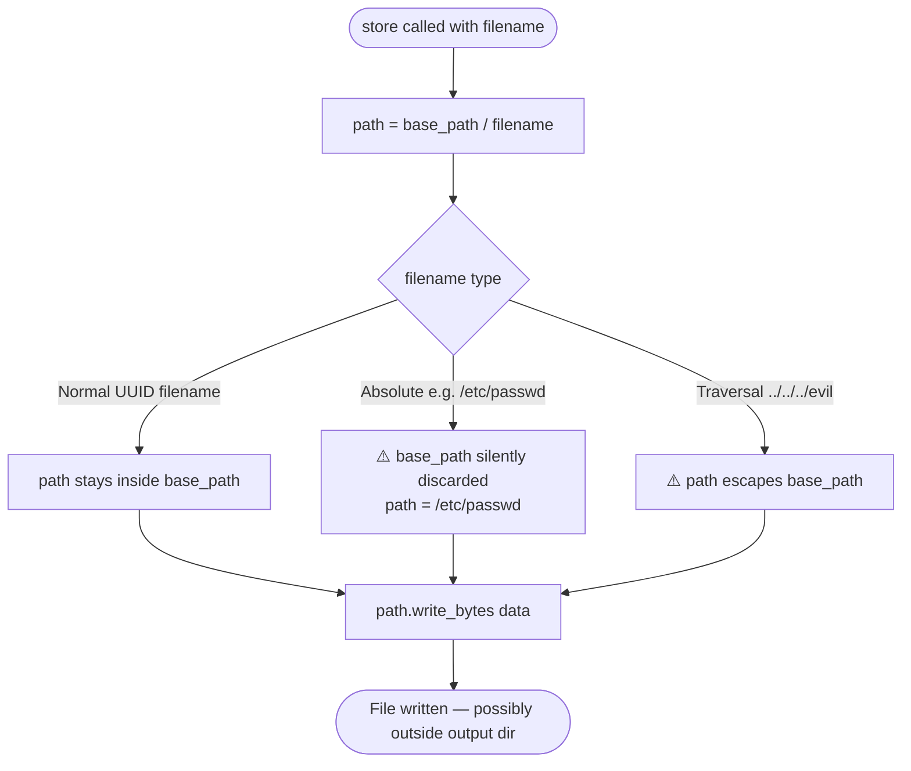
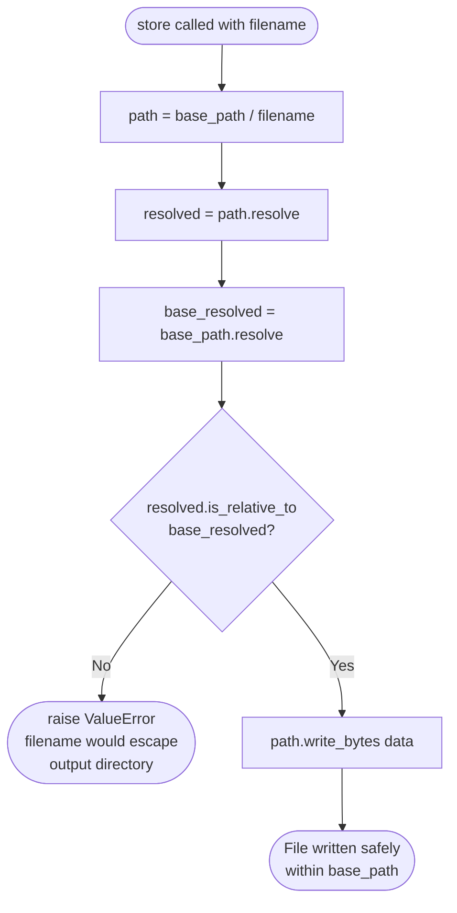

# Fix: `FileSink.store()` No Path-Containment Check (Issue #74)

## Problem

`FileSink.store()` joined `base_path` with an unvalidated `filename` using Python's `pathlib`:
```python
path = self._base_path / filename
```

Python's `/` operator has two silent behaviors:
1. **Absolute path**: `Path("/output") / "/etc/passwd"` → `Path("/etc/passwd")` — `base_path` is silently discarded.
2. **Traversal**: `Path("/output") / "../../../etc/evil"` → normalized path outside `/output`.

Currently not exploitable (all internal callers use UUID-based filenames), but `FileSink` has no defense against malicious or accidental inputs.

## Affected Class

- `FileSink.store()` in `src/sarvam_mcp/audio/sinks.py`

---

## Flow: Before Fix



## Flow: After Fix



---

## Code Change

**File:** `src/sarvam_mcp/audio/sinks.py`

```python
# Before
async def store(self, data: bytes, *, filename: str, mime_type: str) -> StoredAudio:
    self._base_path.mkdir(parents=True, exist_ok=True)
    path = self._base_path / filename
    path.write_bytes(data)
    ...

# After
async def store(self, data: bytes, *, filename: str, mime_type: str) -> StoredAudio:
    self._base_path.mkdir(parents=True, exist_ok=True)
    path = self._base_path / filename
    resolved = path.resolve()
    if not resolved.is_relative_to(self._base_path.resolve()):
        raise ValueError(f"Filename {filename!r} would escape the output directory.")
    path.write_bytes(data)
    ...
```

### Why `resolve()` + `is_relative_to()`?

- `resolve()` expands symlinks and normalizes `..` sequences before comparison.
- `is_relative_to()` (Python 3.9+, safe on 3.11+ target) checks strict containment.
- Together they block both absolute paths and traversal attempts regardless of OS path separator differences.

---

## PR Description

**Title:** fix: reject filenames that escape base_path in FileSink.store (#74)

**Body:**

### Summary

- `FileSink.store()` joined `base_path` with an unvalidated `filename`, allowing absolute paths (`/etc/passwd`) to silently discard `base_path` and `../` sequences to escape the output directory.
- Added `resolve()` + `is_relative_to()` check that raises `ValueError` before any write if the resolved path falls outside `base_path`.

### Changes

- `src/sarvam_mcp/audio/sinks.py`: `FileSink.store` validates filename is contained within `base_path`.

### Test plan

- [ ] `ruff check src/` passes
- [ ] `pytest -q` passes
- [ ] Manual: attempt to store with `filename="../../../etc/evil"` — verify `ValueError` is raised
- [ ] Manual: attempt to store with `filename="/absolute/path"` — verify `ValueError` is raised

Fixes sarvamai/sarvam-mcp#74
