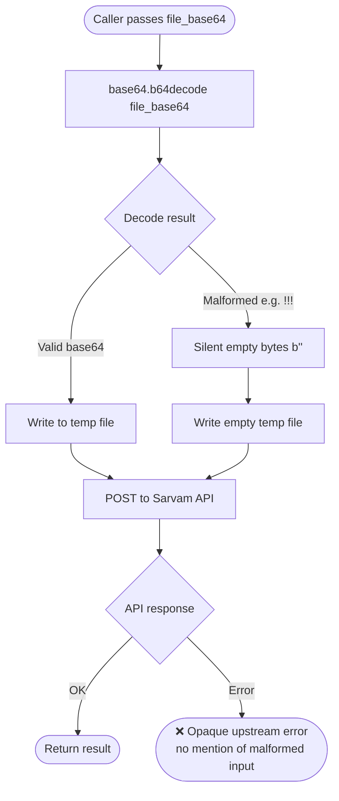
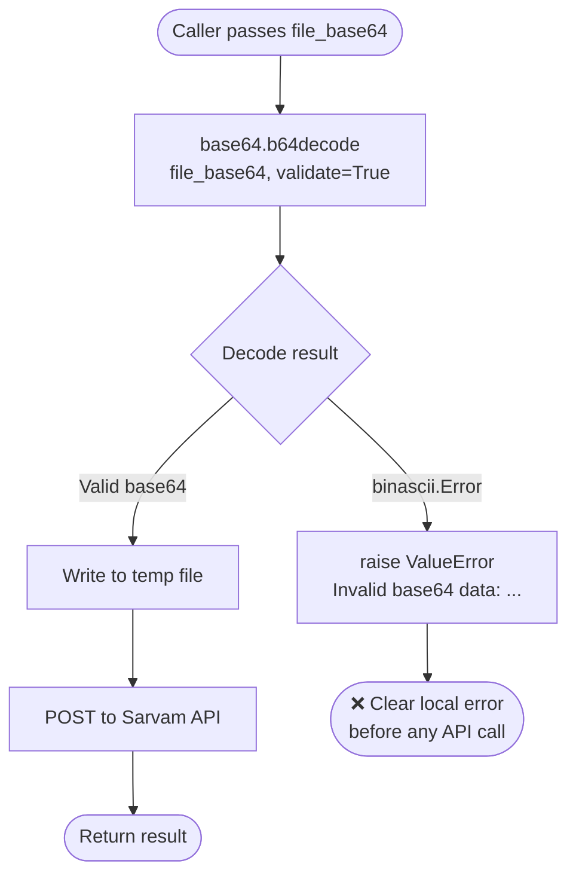

# Fix: `resolve_file_input` Silently Accepts Malformed Base64 (Issue #80)

## Problem

`base64.b64decode()` called without `validate=True` silently ignores non-alphabet characters. A payload like `"!!!!"` decodes to empty bytes `b""`, an empty temp file gets forwarded to the Sarvam API, and the caller receives an opaque upstream error with no indication that the input was malformed.

## Affected Function

- `resolve_file_input` in `src/sarvam_mcp/tools/_common.py`

---

## Flow: Before Fix



## Flow: After Fix



---

## Code Change

**File:** `src/sarvam_mcp/tools/_common.py`

```python
# Before (line 59)
data = base64.b64decode(file_base64)

# After
try:
    data = base64.b64decode(file_base64, validate=True)
except binascii.Error as exc:
    raise ValueError(f"Invalid base64 data: {exc}") from exc
```

Added `import binascii` to the imports section.

### Why `validate=True`?

Without it, `base64.b64decode` ignores characters outside the base64 alphabet (A-Z, a-z, 0-9, +, /, =). This means:
- `"!!!!"` → `b""` (empty)
- `"abc!!!def"` → partial decode of the valid chars only
- Padding errors are silently corrected

With `validate=True`, any non-alphabet character raises `binascii.Error` immediately.

---

## PR Description

**Title:** fix: validate base64 in resolve_file_input (#80)

**Body:**

### Summary

- `base64.b64decode` without `validate=True` silently ignores non-alphabet characters, causing malformed payloads (e.g. `"!!!!"`) to produce empty bytes and forward a corrupt temp file to the Sarvam API.
- Added `validate=True` and catch `binascii.Error`, converting it to a descriptive `ValueError` before any file I/O occurs.

### Changes

- `src/sarvam_mcp/tools/_common.py`: `resolve_file_input` now raises `ValueError` on invalid base64 input.

### Test plan

- [ ] `ruff check src/` passes
- [ ] `pytest -q` passes
- [ ] Manual: call any tool with `audio_base64="!!!!"` — verify a clear `ValueError: Invalid base64 data` is returned instead of an opaque API error

Fixes sarvamai/sarvam-mcp#80

---

## PR Description (PR #101)

> ## Summary
>
> - `base64.b64decode` without `validate=True` silently ignores non-alphabet characters, causing malformed payloads (e.g. `"!!!!"`) to produce empty bytes and forward a corrupt temp file to the Sarvam API.
> - Added `validate=True` and catch `binascii.Error`, converting it to a descriptive `ValueError` before any file I/O occurs.
>
> ## Changes
>
> - `src/sarvam_mcp/tools/_common.py`: `resolve_file_input` now raises `ValueError` on invalid base64 input.
>
> ## Test plan
>
> - [ ] `ruff check src/` passes
> - [ ] `pytest -q` passes
> - [ ] Manual: call any tool with `audio_base64="!!!!"` — verify a clear `ValueError: Invalid base64 data` is returned instead of an opaque API error
>
> Fixes sarvamai/sarvam-mcp#80
