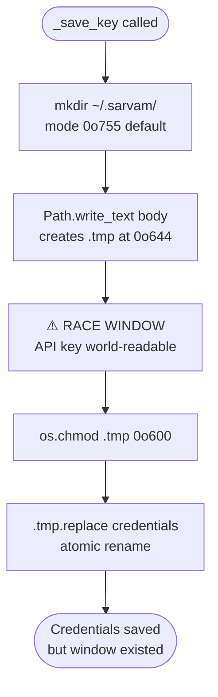
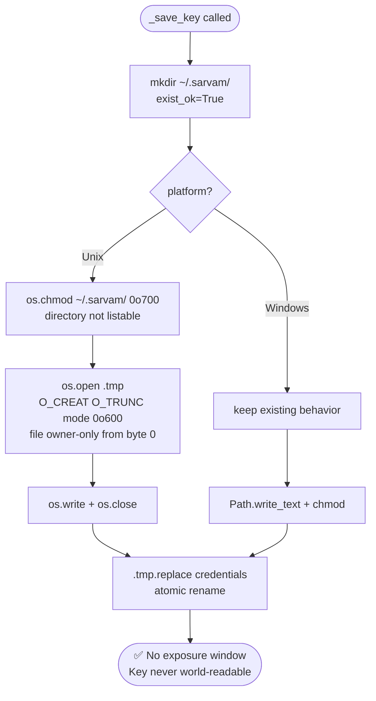

# Fix: API Key Briefly Written World-Readable (Issue #86)

## Problem

`_save_key` in `src/sarvam_mcp/tools/auth.py` created a temporary file via `Path.write_text()`, which uses the process umask (typically `0o644` on Linux). It only called `os.chmod(path, 0o600)` afterward. Between those two calls, the `.tmp` file containing the raw API key was readable by any local user.

Additionally, the `~/.sarvam/` directory was left at `0o755` (world-listable), allowing other users to discover that a credentials file exists.

## Affected Function

- `_save_key` in `src/sarvam_mcp/tools/auth.py`

---

## Flow: Before Fix



## Flow: After Fix



---

## Code Change

**File:** `src/sarvam_mcp/tools/auth.py`

```python
# Before
def _save_key(api_key: str) -> None:
    CREDENTIALS_PATH.parent.mkdir(parents=True, exist_ok=True)
    # ... build body ...
    tmp = CREDENTIALS_PATH.with_suffix(".tmp")
    tmp.write_text(body)           # created at 0o644 ← race window here
    _restrict_permissions(tmp)     # chmods to 0o600 after the fact
    tmp.replace(CREDENTIALS_PATH)

# After
def _save_key(api_key: str) -> None:
    CREDENTIALS_PATH.parent.mkdir(parents=True, exist_ok=True)
    if sys.platform != "win32":
        os.chmod(CREDENTIALS_PATH.parent, 0o700)  # restrict directory
    # ... build body ...
    tmp = CREDENTIALS_PATH.with_suffix(".tmp")
    if sys.platform == "win32":
        tmp.write_text(body)
        _restrict_permissions(tmp)
    else:
        fd = os.open(str(tmp), os.O_WRONLY | os.O_CREAT | os.O_TRUNC, 0o600)
        try:
            os.write(fd, body.encode())
        finally:
            os.close(fd)
    tmp.replace(CREDENTIALS_PATH)
```

### Why `os.open` with mode `0o600`?

`os.open` with `O_CREAT` applies the mode at file creation time. Because `0o600` has no group/world bits, the umask (typically `0o022`) cannot widen it — the file is created owner-only from the very first byte written.

---

## PR Description

**Title:** fix: create credentials file owner-only from the start (#86)

**Body:**

### Summary

- `_save_key` previously created the `.tmp` credentials file at `0o644` (world-readable) and only chmoded to `0o600` afterward, leaving a brief window where the API key was exposed to other local users.
- Replaced `write_text` + `chmod` with `os.open(..., O_CREAT | O_TRUNC, 0o600)` on Unix so the file is never more permissive than `0o600` at any point.
- Also restricts `~/.sarvam/` directory to `0o700` so other users cannot list its contents.

### Changes

- `src/sarvam_mcp/tools/auth.py`: `_save_key` uses `os.open` on Unix; Windows path unchanged.

### Test plan

- [ ] `ruff check src/` passes
- [ ] `pytest -q` passes
- [ ] On Unix: call `sarvam_tools_set_api_key` with a test key, then `stat ~/.sarvam/credentials` — verify mode is `0600` and `~/.sarvam/` is `0700`

Fixes sarvamai/sarvam-mcp#86
